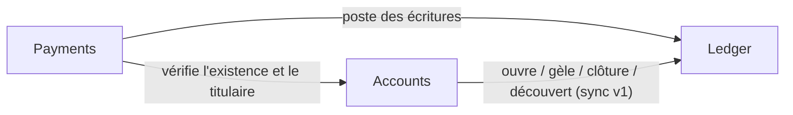

# Périmètre & acteurs

## Le métier en une phrase
Une petite banque de détail, en euros uniquement, qui tient les comptes courants de ses clients, accepte les dépôts et retraits au guichet et exécute des virements entre comptes de la banque, **sans jamais perdre ni créer un centime**.

## Acteurs

| Acteur | Rôle |
|---|---|
| **Client** (titulaire) | Consulte ses comptes et relevés, émet des virements depuis ses comptes |
| **Conseiller** | Inscrit les clients, ouvre, gèle et clôture les comptes, fixe le découvert, opère au guichet, contre-passe des virements |
| **Système** | Réactions automatiques, rapprochement des soldes |

## Bounded contexts (v1)

| Contexte | Responsabilité | Type |
|---|---|---|
| **Accounts** | Titulaires et cycle de vie des comptes (ouverture, gel, clôture, découvert autorisé) | Support |
| **Ledger** | Grand livre en partie double, soldes, règles de débit et crédit | **Cœur** |
| **Payments** | Virements internes, dépôts et retraits au guichet, idempotence, contre-passation | **Cœur** |
| Identity & Access | Authentification et rôles (phase 5) | Générique |

## Dans le périmètre v1
- Inscription d'un titulaire (données minimales : nom, email).
- Comptes courants en EUR, un seul titulaire par compte.
- Découvert autorisé fixé par un conseiller.
- Gel, dégel et clôture d'un compte.
- Dépôt et retrait au guichet.
- Virement interne immédiat entre deux comptes de la banque.
- Contre-passation d'un virement par un conseiller.
- Consultation : solde, solde disponible, relevé, historique des virements.

## Hors périmètre v1 (bonus possibles)
- Virements externes (SEPA) et asynchrones.
- Comptes joints, comptes épargne, intérêts, frais, agios.
- Multi-devises et change.
- Cartes bancaires, prélèvements, virements programmés ou permanents.
- KYC, conformité, lutte anti-blanchiment.
