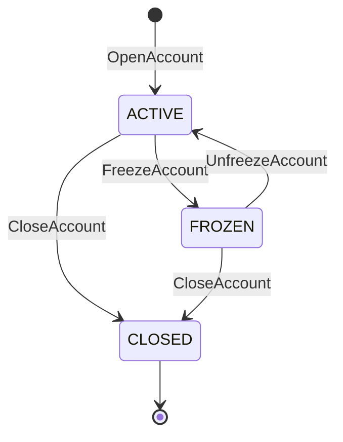
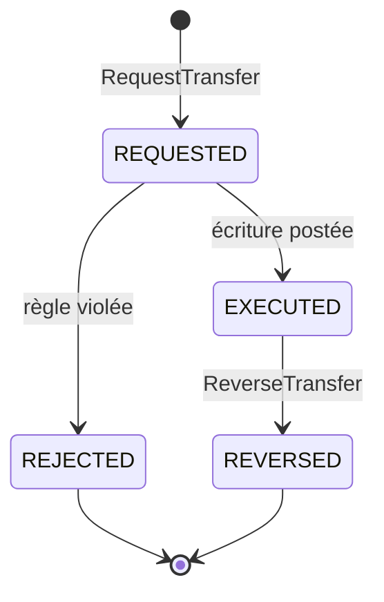
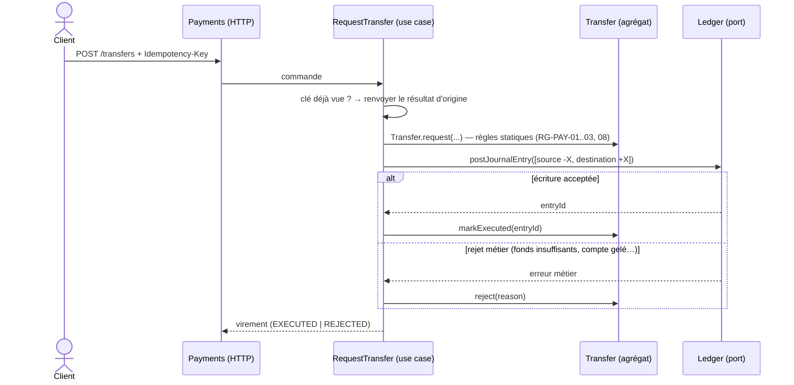

# Event storming (niveau « design de processus »)

Notation : 🟦 Commande · 🟧 Événement · 🟨 Agrégat · 🟪 Politique (réaction) · 🟩 Vue (read model) · 🟥 Hotspot (question ouverte)

---

## Contexte Accounts

| 🟦 Commande | Acteur | 🟨 Agrégat | 🟧 Événement | Règles |
|---|---|---|---|---|
| `RegisterCustomer` | Conseiller | `Customer` | `CustomerRegistered` | RG-ACC-01 |
| `OpenAccount` | Conseiller | `BankAccount` | `AccountOpened` | RG-ACC-02, 03, 04 |
| `ChangeOverdraftLimit` | Conseiller | `BankAccount` | `OverdraftLimitChanged` | RG-ACC-05, 06 |
| `FreezeAccount` | Conseiller | `BankAccount` | `AccountFrozen` | RG-ACC-07 |
| `UnfreezeAccount` | Conseiller | `BankAccount` | `AccountUnfrozen` | RG-ACC-07 |
| `CloseAccount` | Conseiller | `BankAccount` | `AccountClosed` | RG-ACC-08, 09 |

🟪 **Politiques (v1 : appel synchrone dans la même transaction, voir ADR 0008)**
- Quand `AccountOpened` → ouvrir le `LedgerAccount` correspondant (solde 0, découvert initial).
- Quand `OverdraftLimitChanged` → mettre à jour le découvert du `LedgerAccount`. Échoue si RG-ACC-06 est violée.
- Quand `AccountFrozen` / `AccountUnfrozen` → bloquer / débloquer les débits du `LedgerAccount`.
- Quand `AccountClosed` → clôturer le `LedgerAccount`. Échoue si le solde n'est pas nul (RG-ACC-09).

**Machine à états `BankAccount`**

---

## Contexte Ledger

| 🟦 Commande | Déclenché par | 🟨 Agrégat(s) | 🟧 Événement | Règles |
|---|---|---|---|---|
| `OpenLedgerAccount` | Politique Accounts | `LedgerAccount` | `LedgerAccountOpened` | — |
| `UpdatePostingRules` (découvert, blocage) | Politique Accounts | `LedgerAccount` | `PostingRulesUpdated` | RG-ACC-06 |
| `CloseLedgerAccount` | Politique Accounts | `LedgerAccount` | `LedgerAccountClosed` | RG-ACC-09 |
| `PostJournalEntry` | Payments | `JournalEntry` + n × `LedgerAccount` | `JournalEntryPosted` | RG-LED-01 à 07 |
| `ReverseJournalEntry` | Payments | `JournalEntry` + n × `LedgerAccount` | `JournalEntryReversed` | RG-LED-08 |

🟩 **Vues**
- **Solde** : solde, solde disponible, devise.
- **Relevé** : lignes paginées et triées par date, avec solde progressif et libellé.
- **Rapprochement** : liste des écarts entre snapshot et somme des lignes (doit toujours être vide).

---

## Contexte Payments

| 🟦 Commande | Acteur | 🟨 Agrégat | 🟧 Événement(s) | Règles |
|---|---|---|---|---|
| `MakeDeposit` | Conseiller | `CashOperation` | `DepositMade` | RG-PAY-01, 09 |
| `MakeWithdrawal` | Conseiller | `CashOperation` | `WithdrawalMade` / `WithdrawalRejected` | RG-PAY-01, 09 |
| `RequestTransfer` | Client, Conseiller | `Transfer` | `TransferRequested` → `TransferExecuted` / `TransferRejected` | RG-PAY-01 à 09 |
| `ReverseTransfer` | Conseiller | `Transfer` | `TransferReversed` / `TransferReversalRejected` | RG-PAY-10 |

**Machine à états `Transfer`**

**Déroulé d'un virement (v1, synchrone)**

🟥 **Hotspot** : en cas de rejet, la transaction de l'écriture est annulée, mais le `Transfer` rejeté **doit** être persisté pour garder la trace (RG-PAY-07). Il faut donc soit deux transactions, soit une transaction avec un savepoint. À trancher en phase 3.

🟩 **Vues**
- Historique des virements d'un compte (émis et reçus) avec leur statut.
- Détail d'un virement : statut, motif de rejet, référence de l'écriture.

---

## 🟥 Hotspots globaux
1. Découpage Accounts / Ledger : utile, ou sur-ingénierie en v1 ? (ADR 0008)
2. Verrouillage optimiste avec retry ou `SELECT ... FOR UPDATE` : à mesurer avec les tests de concurrence.
3. Persistance d'un `Transfer` rejeté quand la transaction du Ledger est annulée.
4. Une contre-passation peut-elle mettre le destinataire au-delà de son découvert ? (v1 : non, voir RG-PAY-10)
5. `CashOperation` est-il un vrai agrégat, ou un simple use case qui poste dans le Ledger ? (à challenger)
